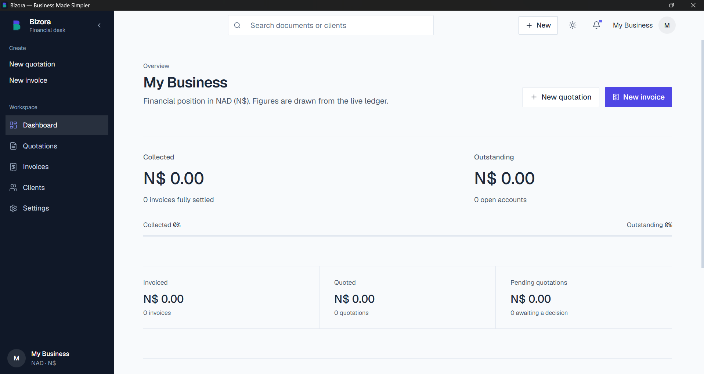

<div align="center">

  

  <h1>Bizora</h1>

  <p><strong>Business Made Simpler.</strong></p>

  <p>A Windows desktop app for managing clients, quotations, invoices, payments, and business assets.</p>

  <p>
    
    
    
    
    
  </p>

</div>

## Preview

<div align="center">
  
</div>

## Features

- Dashboard overview
- Client management
- Quotation creation and PDF export
- Invoice creation and PDF export
- Payment tracking
- Business asset records
- Local SQLite data storage

## Download

Windows installers are available from [GitHub Releases](https://github.com/josephamwaalwa/bizora-ai-studio-staging/releases).

## Built with

React · TypeScript · Vite · Tailwind CSS · Tauri 2 · Rust · SQLite

## Development

**Prerequisites:** Node.js, npm, Rust, and the Windows prerequisites for Tauri.

```bash
git clone https://github.com/josephamwaalwa/bizora-ai-studio-staging.git
cd bizora-ai-studio-staging
npm install
npm run tauri:dev
```

Build the Windows app:

```bash
npm run tauri:build
```

## Storage & Authentication

Bizora stores business records locally in SQLite. Sign-in is provided through Supabase (email/password and Google). Business-data cloud sync is not currently available.

---

<div align="center">
  <sub>Bizora — Business Made Simpler.</sub>
</div>
